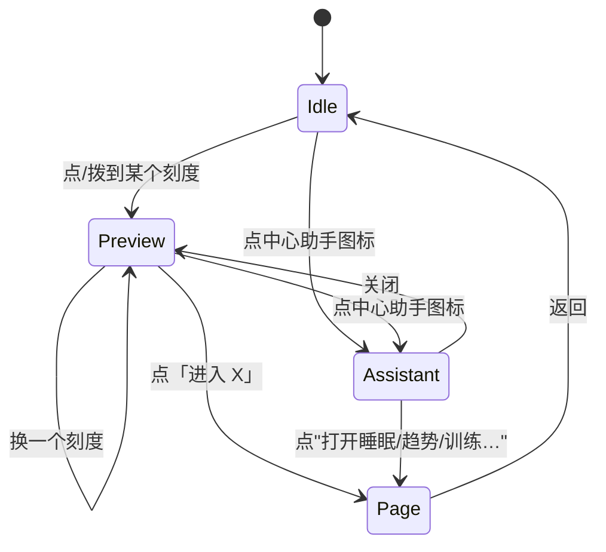

# Chronos 拨盘 + 中心助手：设计思路（T11 参考）

- 来源：用户 2026-10-21 描述——"一个类似智能语音助手的图标，周围是刻度；拨到不同刻度，
  不同的功能界面出现在中间或周围；不拨动而点中间，则弹出助手，可以输入问题，
  也可以让它打开对应功能页面或数据"
- 参考原型：`Lumen-visual-prototype-v4-bugfix.html`（用户提供，2026-10-21）
- 当前预览：`docs/preview/chronos-dial-v3.html`（零 JS，双击打开；含浅色/深色切换）
- 截图（本地验证产物，已被 `.gitignore` 排除，不进仓库）：`docs/assets/screenshots/chronos-v3-{idle,training,assistant,dark,phone}.png`；版式预览见 `docs/preview/chronos-dial-v3.html`
- 旧预览：`docs/preview/chronos-dial-v2.html`（v3 之前的讨论稿，仅留档）
- 状态：**T11 已整合进生产路由（六刻度拨盘 + 中心助手 + 拖拽增强），待用户审核**。

---

## 0. 参考 Lumen V4 后的取舍（2026-10-21 更新）

用户的参考原型把方向定得更清楚了：**中心式健康时钟 + 拨盘 + 中心助手球 + 底部助手抽屉**。
逐项裁决如下：

| 原型特性 | 裁决 | 说明 |
|---|---|---|
| 中心式布局、12 粗 + 24 细分刻度、金属表圈 | **采纳** | 与现有 6 扇区语义兼容：6 个偶数刻度绑功能，其余是节奏刻度 |
| 闲置态：中心助手球 + 呼吸光环 + "点我唤醒助手" | **采纳** | 完全对应用户说的"不拨动而点击中间则弹出智能助手" |
| 选中态：中心放大为功能卡（数值 + 迷你走势 + 两列事实 + 进入） | **采纳** | 数据全部来自 `build_guidance()` / `summarize()`，与 Simple 同源 |
| 当前扇区高亮弧（跟随功能色） | **采纳** | 颜色只标"哪个功能被选中"，不是评分 |
| 指针 + 表冠 | **采纳** | 指向选中刻度；闲置态淡化 |
| 功能标签闲置带名字、选中后其余缩成小圆环 | **采纳，先修再用** | 原型缩成 26px，**触控命中区不足 44px**；预览已用伪元素补到 44px |
| 底部助手抽屉（建议 + 输入框） | **采纳** | 助手回答先做"关键词匹配 + 本地模板"（与原型 mock 同思路），真模型属 T12 |
| 快捷 chips 一排 | **采纳** | 与表盘标签同一组状态，零 JS 可实现 |
| 助手代填训练记录 | **已批准（用户 2026-10-21）** | 只允许"预填表单 + 用户确认提交"：助手把建议参数（类型/部位/时长）写进表单，落库仍走 POST + CSRF，助手不直接写库 |
| 深色主题 | **不必（用户 2026-10-21 裁决）** | 维持项目浅色 token；v3 预览已移除深色切换 |
| 拖拽旋转 + 吸附 | **已批准（用户 2026-10-21）** | T11 按 §6 缓解措施实现：拖拽只改预览不导航、键盘/点击全程可用、`prefers-reduced-motion` 禁用惯性、无脚本时退化 |
| 详情页弹层（detail modal） | **不采纳** | 本项目点「进入」走真实路由，数据口径已经统一，弹层反而造成两套展示 |
| 首屏介绍页（intro screen） | **不采纳** | 已有真实首页承担"今日概览" |
| 数字滚动动画（rollNumber） | **不采纳** | 数字滚动会暗示"数值在变好/变坏"，与"只观察不评判"的定位冲突 |

预览页里的演示数字（昨夜 5h50m、静息心率 58、本周 2 次训练、1 条提醒）与 `scripts/demo_guidance.py`
的合成数据一致，T11 实施时中心卡可以直接换成真数据。

---

## 0.1 中心显示不全的修复（2026-10-21，采纳原型的外环缩放逻辑）

问题：v2 里中心卡内容在 390px 视口会被圆边裁掉。参考原型在 390px 也有同样问题
（实测「进入」按钮超出中心圆 **+20px**）。

修复（v3，已按你的建议引入原型的缩放逻辑）：

1. **整盘缩放**：`.dialstage{width:min(86vw,470px)}`，刻度/标签/中心全部按容器百分比定位，
   小屏上是"整盘缩小"，而不是砍内容；
2. **中心让位**：选中态中心 52% → **72%**（与原型一致），细分刻度淡出，标签缩成小圆环；
3. **比例字号**：卡内所有字号/间距改为 `clamp(下限, vw系数, 上限)` —— 中心圆变小，文字同步变小，
   不再依赖"隐藏元素"；
4. **小屏只收紧排版**（facts 单列），不再删除信息。

实测（选中「训练」，卡内最深元素与中心圆边缘的距离，负数 = 在圆内）：

| 视口 | 表盘宽 | 中心占比 | 内容超出圆边 |
|---|---|---|---|
| 1200 | 470 | 72% | **-24px**（圆内） |
| 768 | 470 | 72% | **-24px** |
| 480 | 413 | 72% | **-21px** |
| 390 | 335 | 72% | **-17px** |

几何校验：卡片每个区块的四角到中心距离均 ≤ 半径（四角全部在圆内）。对比原型在 390px 的 +20px 超出，问题消除。

---

## 1. 一句话方案

---

## 1. 一句话方案

把现在的"六扇区表盘"升级为**双层结构**：

- **外层是刻度盘**：36 格细刻度、12 格粗刻度，其中 6 个刻度绑定功能（睡眠/趋势/训练/提醒/报告/设置）；
- **中心是助手**：默认显示当前刻度的预览摘要；点中心进入助手模式，可输入问题或让它打开页面；
- **预览与进入分离**：拨到刻度只换中心预览，点「进入」才导航——沿用现有零 JS 表盘的"两步交互"。

---

## 2. 交互状态机

| 状态 | 中心显示 | 外圈 | 可做的操作 |
|---|---|---|---|
| Idle | 今日建议一句话 + 数据新鲜度 | 刻度静止，当前刻度高亮 | 点刻度、点中心 |
| Preview | 该功能的摘要（值 + 覆盖度 + 一条依据） | 指针指向该刻度 | 进入、换刻度、点中心 |
| Assistant | 输入框 + 3 个快捷指令 | 刻度淡化（不隐藏） | 输入、点快捷指令、关闭 |
| Page | 离开表盘 | — | 返回 |

---

## 3. 刻度与功能的映射

12 个粗刻度，6 个绑定功能，其余 6 个是"空刻度"（只提供节奏，不绑定页面）：

| 刻度（从 12 点顺时针） | 角度 | 绑定 |
|---|---|---|
| 0 | 0° | 睡眠 `/sleep` |
| 2 | 60° | 趋势 `/trends` |
| 4 | 120° | 训练 `/training` |
| 6 | 180° | 提醒 `/alerts` |
| 8 | 240° | 报告 `/reports` |
| 10 | 300° | 设置 `/settings` |

说明：
- 现有表盘是"睡眠/趋势/导入/提醒/报告/设置"，本方案把 **导入换成训练**；导入仍在侧栏与普通入口，
  因为导入是低频动作，不值得占一个主刻度。
- 空刻度不显示文字，只显示刻度线；后续要把"体重/体重趋势"等加进来时，空位就是扩展点。

---

## 4. 数据从哪来（不许另算一套）

| 中心内容 | 数据源 | 复用 |
|---|---|---|
| 今日建议一句话 | `guidance.build_guidance()` | 与 Simple 首页同一对象 |
| 睡眠预览 | `analytics.summarize()` | 与 `/sleep` 同一函数 |
| 趋势预览 | 同上 + `ui/charts.py` | 与 `/trends` 同一函数 |
| 训练预览 | `training_store.list_sessions()` + guidance | 与 `/training` 同源 |
| 提醒预览 | `alerts.count_unread()` + 最近一条 | 与 `/alerts` 同源 |
| 报告预览 | `reports.build_daily()` 的标题与日期 | 与 `/reports` 同源 |
| 助手回答 | **本地事实 + T12 解释层** | 不允许助手自己查库、自己改结论 |

**硬约束**：表盘颜色、角度、亮度都不得表示"健康评分"。它只表示"哪个功能被选中"。

---

## 5. 零 JS 能做到哪一步

| 交互 | 零 JS | 说明 |
|---|---|---|
| 点刻度切换预览 | ✅ | 单选控件 + CSS `:checked`，预览页已实现 |
| 键盘切换刻度 | ✅ | Tab 聚焦 + 方向键切换 radio |
| 指针/预览切换动画 | ✅ | CSS transition，尊重 `prefers-reduced-motion` |
| 点中心打开助手 | ✅ | 同一组 radio 的一个选项 |
| 拖拽旋转表盘 | ❌ | 需要监听指针事件、计算角度、吸附刻度 |
| 手势惯性/回弹 | ❌ | 需要 JS 与动画循环 |
| 助手对话 | ❌ | 需要 T12 的网络调用与流式输出 |

结论：**不做拖拽也能完整使用**。拖拽是"手感升级"，不是功能前提。

---

## 6. 如果要拖拽，需要单独批准（T11 门禁）

按 `docs/06-ui-extension-guide.md` §5，打破零 JS 必须提交理由与可访问性影响：

**理由**：12.7 英寸平板上，拖拽比连点 6 个标签更接近"拨盘"的直觉；刻度密度足够时，拖拽能快速扫过预览。

**代价与缓解**：

| 风险 | 缓解 |
|---|---|
| 键盘用户无法拖拽 | 保留点击与方向键；拖拽只是增强，不是唯一路径 |
| 触屏误触导致跳页 | 拖拽只改预览，不导航；导航仍需点「进入」 |
| 动画引起眩晕 | 拖拽跟手但不自动旋转；`prefers-reduced-motion` 下禁用惯性 |
| 脚本失败 | 无脚本时退化为现在的单选表盘，页面仍可用 |
| 性能 | 只在 `pointerdown` 时绑定，`pointerup` 解绑；不用 `requestAnimationFrame` 常驻 |

**建议**：T11 先做零 JS 版本（点击/键盘），把拖拽作为独立开关 `?dial=drag` 的增强，
默认关闭；等你实机试用后再决定是否默认开启。

---

## 7. 助手入口的边界（重要）

用户描述里的"智能助手"容易被理解成"什么都能做"。本方案把它限制为三类动作：

1. **解释已有结论**：为什么今天建议休息/轻松活动（只读 `guidance` 的 evidence 与 uncertainty）；
2. **导航**：把"打开睡眠页/训练页"翻译成链接，不做任意路由跳转；
3. **查询已有数字**：如"上周睡眠均值"，只回答报告/聚合层已经算出的值。

明确不做：

- 不诊断、不预测疾病、不给药物/补剂建议；
- 不直接写库（记录训练仍走表单，助手最多帮你预填）；
- 不把整库、截图、记录 ID 发给模型；
- 不在用户没点"发送"时调用云端。

技术上，助手 = **意图分类 + 本地事实检索 + 可选解释**，不是让模型自由发挥的聊天窗口。
T12 实现时沿用 `guidance/explain.py` 的摘要与输出校验。

---

## 8. T11 实施顺序（审核通过后）

1. 把 `pages.py` 的表盘从 6 扇区改为"6 个绑定刻度 + 6 个空刻度"，保持 `DIAL_PAGES` 仍是 6；
2. 抽出 `context.py::dial_preview(page_key)`，中心预览与 Simple 复用同一取数函数；
3. 模板改成 radio + CSS（参考预览页），保留现有键盘与减少动态逻辑；
4. 助手入口先只做面板与快捷指令，不接模型（T12 再接线）；
5. 测试：
   - 6 个刻度都能选中，预览内容与对应页面同源；
   - 点「进入」才发生导航；
   - 无 JS 时全部功能可用；
   - 键盘方向键可切换；
   - 减少动态下无过渡；
   - 表盘不出现"评分/健康分"字样。

---

## 9. 三个问题的裁决与落地（用户 2026-10-21 回复）

| 问题 | 裁决 | 落地方式 |
|---|---|---|
| 深色主题 | **不必** | 维持浅色 token；预览已移除深色切换 |
| 拖拽旋转 | **可以做** | T11 实现：拖拽只改预览不导航；键盘/点击全程可用；`prefers-reduced-motion` 禁用惯性；无 JS 时退化为单选表盘 |
| 助手代填训练记录 | **允许** | 只做"预填 + 确认"：助手把建议参数填进表单，用户点「保存训练」才落库（POST + CSRF + 校验）；助手不直接写库，也不会替用户跳过确认 |

T11 实施顺序不变（§8），新增两条验收：

- 拖拽换刻度时，中心预览内容与点击同一刻度完全一致（同源）；
- 助手预填的表单必须展示"来自助手"标识，用户可修改任意字段后再提交。

仍待确认的一项：

- 6 个刻度是否就用"睡眠 / 趋势 / 训练 / 提醒 / 报告 / 设置"（默认按此做，不同意再调）。
